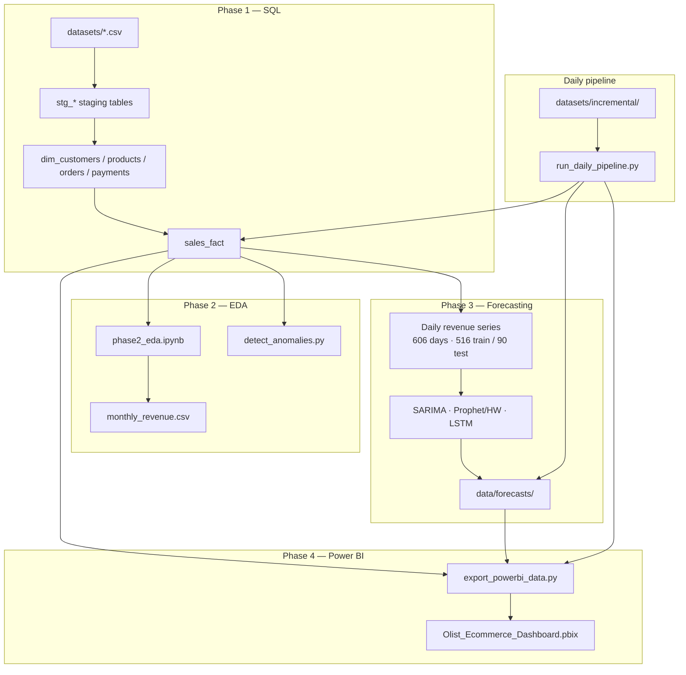

# E-Commerce Sales Forecasting & Intelligent Reporting: A Data-Driven Research Report

**Project:** E-Commerce Sales Forecasting & Intelligent Reporting  
**Dataset:** Olist Brazilian E-Commerce (8 core CSV tables, 2016–2018)  
**Period:** June 2026  
**Stack:** Python, MySQL 8.0, statsmodels (SARIMA), Prophet / Holt-Winters, TensorFlow (LSTM), Power BI  

---

## Abstract

This study presents an end-to-end e-commerce analytics and forecasting pipeline across four phases: SQL dimensional modeling, Python exploratory analysis, multi-model time-series forecasting, and Power BI executive reporting. The Olist dataset is operationalized in MySQL as a line-item `sales_fact` table (~110k delivered rows), analyzed in Jupyter for revenue, category, and regional patterns, and forecast at 30 / 60 / 90-day horizons using SARIMA, Prophet (with Holt-Winters fallback), and LSTM. After light validation-based hyperparameter tuning, **LSTM achieved the lowest 30-day MAPE (17.6%)** and **60-day MAPE (23.7%)**; Prophet/Holt-Winters led at short horizons among classical models (30-day MAPE 29.3%). Insights are exported to CSV, cross-validated against SQL, visualized in a four-page futuristic Power BI dashboard, and refreshed through a daily pipeline with z-score anomaly detection.

**Keywords:** E-commerce, sales forecasting, SARIMA, Prophet, LSTM, MySQL, Power BI, anomaly detection, Olist

---

## 1. Introduction

### 1.1 Background

E-commerce operators need reliable demand signals to plan inventory, marketing spend, and regional expansion. Historical order data contains trend, weekly seasonality, and promotional spikes (e.g. Black Friday) that classical statistics and modern sequence models can capture differently. Pairing a SQL analytics layer with Python forecasting and a self-service dashboard gives both reproducible pipelines and business-facing KPIs.

### 1.2 Objectives

1. Ingest and model Olist order data in MySQL with a star-schema-style `sales_fact` at line-item grain.
2. Perform exploratory analysis in Python (revenue trends, categories, regions, payment behavior, anomalies).
3. Forecast daily revenue at 30, 60, and 90 days using SARIMA, Prophet, and LSTM with comparable metrics.
4. Deliver a four-page Power BI dashboard with executive KPIs, forecast overlays, product insights, and regional maps.
5. Support daily refresh via an idempotent pipeline when new incremental CSVs arrive.

### 1.3 Scope

Phases 1–4 cover SQL BI, Python EDA, forecasting, and Power BI. Raw Olist CSVs live in `datasets/` locally; large files are not assumed to be version-controlled. Geolocation staging is excluded; customer state and city suffice for regional analysis. Only **delivered** orders contribute to revenue metrics.

---

## 2. Related Work

Retail and marketplace forecasting commonly combines:

- **Classical ARIMA / SARIMA** for interpretable trend and seasonal differencing.
- **Prophet** (or exponential smoothing) for robust handling of holidays and multiple seasonalities.
- **Recurrent neural networks (LSTM)** for nonlinear patterns when sufficient history exists.

Enterprise analytics stacks typically mirror this project: **ETL → relational warehouse → Python ML → BI layer**. The Olist benchmark is widely used for customer analytics; this project extends it with walk-forward evaluation, validation-based tuning, anomaly flags, and a production-style daily orchestrator.

---

## 3. Dataset

| Attribute | Detail |
|-----------|--------|
| Source | Olist Brazilian E-Commerce Public Dataset (Kaggle) |
| Core files | 8 CSVs: orders, order items, customers, products, payments, category translation, sellers, reviews |
| Staging volume | ~99k orders, ~113k line items, ~104k payment rows |
| Analytical grain | One row per **delivered** order line item in `sales_fact` |
| `sales_fact` rows | **110,197** (Power BI export; aligned with MySQL) |
| Unique orders (delivered) | **96,478** |
| Total revenue | **R$ 15,419,773.75** |
| Average order value (AOV) | **R$ 159.83** |
| Date span | Sep 2016 – Aug 2018 (forecasting uses daily series from **2017-01-01**) |
| Product categories | 71 (English names via translation table) |
| MySQL database | `olist_analytics` — 8 staging tables, 4 dimension tables, `sales_fact` |

**Data quality decisions:**

- Revenue = `price + freight_value` per line item.
- Non-delivered orders excluded from `sales_fact`.
- Primary payment per order selected via `ROW_NUMBER()` on `payment_sequential`.
- Missing calendar days in daily revenue resampled to **zero** (no imputation).
- Category names mapped to English; `unknown` when translation missing.

---

## 4. System Architecture



---

## 5. Methodology

### 5.1 Phase 1 — SQL Dimensional Model

| Step | Script / file | Output |
|------|---------------|--------|
| Database setup | `sql/01_create_database.sql` | `olist_analytics`, user `olist_user` |
| DDL | `sql/02_create_tables.sql` | 8 staging + 4 dimension tables |
| Load | `scripts/load_csv_to_mysql.py` | Populated `stg_*` |
| Transform | `sql/03_sales_fact.sql` | `dim_*` + `sales_fact` |
| Analytics | `sql/04_analytical_queries.sql` | 15 business queries (+ anomaly query) |
| Orchestration | `scripts/run_pipeline.py` | Full one-time pipeline + validation |

**`sales_fact` grain:** `(order_id, order_item_id)` with `order_date`, `customer_state`, `product_category`, `total_revenue`, `payment_type`, `delivery_time_days`.

### 5.2 Phase 2 — Exploratory Analysis

`notebooks/phase2_eda.ipynb` connects to MySQL and reproduces SQL aggregates in pandas:

| Analysis | Method | Key finding |
|----------|--------|-------------|
| Monthly revenue | Resample vs SQL Query #2 | Cross-validation max diff **< R$ 0.01** |
| Category mix | `GROUP BY product_category` | Long-tail categories; top categories drive majority share |
| Regional revenue | State / city aggregation | **SP** leads (~R$ 5.77M) |
| Repeat customers | SQL Query #7 | **3.0%** repeat rate (low loyalty in sample) |
| Payment mix | `payment_type` distribution | Credit card dominant; installments skewed (median ~3x) |
| Anomalies | Z-score + rolling deviation | Spikes/drops logged to `data/daily_anomalies.csv` |

`scripts/cross_validate.py` confirms Python monthly totals match SQL Query #2 exactly.

### 5.3 Phase 3 — Time-Series Forecasting

**Series construction:** `fetch_daily_revenue()` from `sales_fact`; continuous daily index from 2017-01-01; 606 observations total.

**Train / test split (time-based, no shuffle):**

| Set | Days | Role |
|-----|------|------|
| Train | 516 | Model fitting |
| Validation (within train) | Last 30 of train | Hyperparameter selection |
| Test | 90 (holdout) | Final MAE / RMSE / MAPE at 30 / 60 / 90 horizons |

**Tuning grids** (`scripts/forecast_utils.py`, `VAL_SIZE=30`):

| Model | Grid | Selection criterion |
|-------|------|---------------------|
| SARIMA | 4 orders × 3 seasonal orders | **Lowest AIC** (tie-break: validation MAPE) |
| Prophet | 3×2 prior scales | Lowest validation MAPE |
| Holt-Winters | additive/multiplicative × damped | Lowest validation MAPE (Windows fallback when Stan fails) |
| LSTM | lookback ∈ {28, 35, 42} | Lowest validation MAPE on 7-day chunks |

**Model specifications:**

- **SARIMA:** `statsmodels.SARIMAX`; weekly seasonality period 7; rolling 7-day walk-forward helper for production simulation.
- **Prophet:** `weekly_seasonality=True`, `yearly_seasonality=True`; on Windows/Python 3.13, Stan may fail → **Holt-Winters** substitute with same API surface in notebook.
- **LSTM:** Features = scaled revenue + cyclical day-of-week (sin/cos); architecture LSTM(64) → Dropout(0.2) → Dense(7); **7-day direct chunks** (not recursive 1-step); early stopping patience 8.

**Metrics:**

| Metric | Business meaning |
|--------|------------------|
| MAE | Average error in BRL |
| RMSE | Penalizes large misses (promotional spikes) |
| MAPE | Percent error (zero-revenue days excluded) |

### 5.4 Phase 4 — Power BI Dashboard

| Step | Script | Output |
|------|--------|--------|
| Export | `scripts/export_powerbi_data.py` | 10 CSVs in `data/powerbi/` |
| Validate | `scripts/validate_powerbi_export.py` | Row count + AOV cross-check vs SQL |
| PBIP scaffold | `scripts/generate_powerbi_pbip.py` | `powerbi/Olist_Ecommerce_Dashboard.pbip` |
| Theme / DAX | `powerbi/theme/OlistFuturistic.json`, `powerbi/dax/measures.dax` | Dark neon styling + KPI measures |

**Semantic model (key relationships):**

- `sales_fact[order_date]` → `dim_date[date]` (*:1)
- `fact_daily`, `fact_monthly`, `forecast_vs_actual` → `dim_date`

**Four report pages:**

| Page | Focus | Primary visuals |
|------|-------|-----------------|
| 1 — Executive Overview | KPIs + monthly trend | Total Revenue, Orders, AOV, Growth % |
| 2 — Sales Trends | Daily/monthly + forecast overlay | `forecast_vs_actual` by model (ARIMA, Prophet, LSTM) |
| 3 — Product Insights | Category leaders & laggards | Top-10 bar, bottom-tier product table |
| 4 — Regional Analysis | Brazil map + city bars | State map, MoM growth table |

Deliverable: **`Olist_Ecommerce_Dashboard.pbix`** (project root / `powerbi/`).

### 5.5 Daily Pipeline

`scripts/run_daily_pipeline.py` orchestrates:

1. `load_incremental.py` — append `datasets/incremental/*.csv`
2. `validate_sql.py` — rebuild `sales_fact` from full staging
3. `detect_anomalies.py` — flag spikes/drops
4. `export_powerbi_data.py` — refresh dashboard CSVs
5. `run_forecast.py` — refresh `data/forecasts/`

Staging primary keys prevent duplicate inserts; fact rebuild is **idempotent**.

---

## 6. Results

### 6.1 Business KPIs (Delivered Orders)

| KPI | Value |
|-----|-------|
| Total revenue | R$ 15,419,773.75 |
| Total orders | 96,478 |
| Line items (`sales_fact`) | 110,197 |
| Average order value | R$ 159.83 |
| Top state | SP (R$ 5,769,703.15) |
| Repeat customer rate | 3.0% |
| Peak month (revenue) | 2017-11 (R$ 1,153,364 — Black Friday effect) |

### 6.2 Model Comparison (90-Day Holdout Test)

Metrics from `data/forecasts/model_comparison.csv` after light validation tuning:

| Model | Horizon | MAE (BRL) | RMSE (BRL) | MAPE (%) |
|-------|---------|-----------|------------|----------|
| **LSTM** | 30 | **5,791** | **7,919** | **17.6** |
| Prophet / HW | 30 | 10,327 | 11,706 | 29.3 |
| ARIMA | 30 | 11,450 | 12,632 | 33.1 |
| **LSTM** | 60 | **6,514** | **8,454** | **23.7** |
| Prophet / HW | 60 | 10,498 | 12,000 | 30.3 |
| ARIMA | 60 | 12,238 | 13,986 | 35.0 |
| ARIMA | 90 | 14,947 | 17,355 | **57.7** |
| Prophet / HW | 90 | 12,888 | 14,869 | 60.2 |
| LSTM | 90 | 8,767 | 11,735 | 67.6 |

**Interpretation:**

- **LSTM** wins at **30- and 60-day** horizons (lowest MAE/RMSE/MAPE), benefiting from day-of-week features and 7-day direct prediction chunks.
- **ARIMA** is most competitive at **90 days** among the three (lowest MAPE ~57.7%), though all models degrade at longer horizons when promotional spikes fall outside the training pattern.
- **Prophet / Holt-Winters** offers a strong classical baseline at 30–60 days without GPU training.
- Black Friday (2017-11-24) and other spike days inflate RMSE for every model.

### 6.3 Forecasting Data Dimensions

| Artifact | Shape / count |
|----------|----------------|
| Daily revenue series | 606 days (2017-01-01 onward) |
| Train / test | 516 / 90 days |
| LSTM training sequences | ~(486, lookback, 3 features) with lookback ∈ {28, 35, 42} |
| `forecast_vs_actual.csv` | 270 rows (90 days × 3 models, long format) |
| `model_comparison.csv` | 9 rows (3 models × 3 horizons) |

### 6.4 Power BI Validation

`scripts/validate_powerbi_export.py` confirms:

- `sales_fact.csv` row count matches MySQL `sales_fact`
- AOV from CSV matches SQL Query #5 (**R$ 159.83**)
- Monthly revenue totals match SQL Query #2

### 6.5 Anomaly Detection Sample

Daily revenue anomalies (z-score + rolling baseline) highlight:

- **Spikes:** promotional peaks (e.g. November 2017)
- **Drops:** post-holiday troughs and low-volume days

Outputs: `data/daily_anomalies.csv`, `data/daily_anomalies_chart.png` for operational review.

---

## 7. Discussion

### 7.1 Business Insights

1. **São Paulo (SP) concentration** — A large share of revenue sits in one state; regional expansion opportunities exist in under-indexed states.
2. **Low repeat rate (3%)** — Retention programs could materially lift lifetime value in this marketplace snapshot.
3. **Strong seasonality** — Weekly patterns and November promotions dominate; models that encode seasonality (SARIMA, HW, LSTM with DOW features) outperform naive baselines at short horizons.
4. **Credit-card installments** — Majority of card orders use multi-installment plans (median ~3); relevant for cash-flow forecasting though not yet a forecast regressor.
5. **Unified KPI layer** — SQL → CSV → Power BI with validation scripts prevents dashboard drift from the warehouse.

### 7.2 Limitations

- Olist data ends **Aug 2018**; patterns may not transfer to current macro or post-pandemic e-commerce.
- **Delivered-only** filter excludes in-flight and cancelled demand signals.
- **Prophet on Windows** may run Holt-Winters fallback when Stan/cmdstan is unavailable (Python 3.13).
- **LSTM 90-day MAPE** rises sharply (~67.6%) — chunk compounding and limited history for deep learning.
- Geolocation and seller dimensions excluded; product text / marketing spend not modeled.
- Power BI uses **Import mode CSVs**; live DirectQuery to MySQL is optional but not the default path.

### 7.3 Recommendations

| Priority | Action |
|----------|--------|
| High | Add holiday / promotion regressors (Black Friday flag) to Prophet and LSTM |
| High | Ensemble SARIMA + LSTM for 60–90 day horizons to balance stability and nonlinearity |
| Medium | Enable true Prophet Stan backend (Linux or Python 3.11 venv) for component decomposition |
| Medium | Extend `sales_fact` with installment-weighted payment features for cash-flow forecasts |
| Medium | Schedule `run_daily_pipeline.py` via Task Scheduler / cron with email on anomaly spikes |
| Low | Publish `.pbix` + theme to Power BI Service with scheduled refresh |

---

## 8. Conclusion

This report documents a four-phase e-commerce analytics framework: MySQL dimensional modeling produced a validated **110k-row `sales_fact`**; Python EDA quantified **R$ 15.4M** revenue with SP-led regional concentration; three forecasting approaches were tuned on a **516/90-day split**, with **LSTM leading at 30–60 days** (MAPE 17.6% / 23.7%); and a **four-page Power BI dashboard** operationalizes KPIs, forecast overlays, product tiers, and Brazil regional views. A daily idempotent pipeline ties ingestion, anomaly detection, forecasting, and BI export into a single command.

**Future work:** Holiday-aware feature store, hierarchical forecasting by category/state, Prophet-on-Linux production job, and REST API serving latest 30-day forecast from `data/forecasts/`.

---

## 9. References

1. Olist Brazilian E-Commerce Dataset — Kaggle / Public API.
2. MySQL 8.0 Reference Manual — window functions, `DATEDIFF`, views.
3. statsmodels documentation — `SARIMAX`, Augmented Dickey-Fuller tests.
4. Facebook Prophet — additive forecasting with seasonality priors.
5. TensorFlow / Keras — LSTM sequence modeling.
6. Microsoft Power BI documentation — DAX measures, filled maps, synced slicers.
7. Hyndman, R.J., & Athanasopoulos, G. — *Forecasting: Principles and Practice* (exponential smoothing, ARIMA).

---

## Appendix A — Repository Map

| Path | Purpose |
|------|---------|
| `sql/` | Phase 1 DDL and 15 analytical queries |
| `scripts/` | Pipeline, loader, forecasting, Power BI export |
| `notebooks/phase2_eda.ipynb` | Phase 2 exploratory analysis |
| `notebooks/phase3_forecasting.ipynb` | Phase 3 model comparison |
| `data/forecasts/` | `model_comparison.csv`, `forecast_vs_actual.csv` |
| `data/powerbi/` | Power BI Import CSVs |
| `powerbi/` | PBIP project, theme, DAX, assets |
| `Olist_Ecommerce_Dashboard.pbix` | Final dashboard deliverable |
| `docs/` | `DATA_PIPELINE.md`, `PHASE3_FORECASTING.md`, `PHASE4_POWERBI.md` |

## Appendix B — Reproducibility Commands

```bash
pip install -r requirements.txt
python scripts/run_pipeline.py
python scripts/cross_validate.py
python scripts/run_forecast.py
python scripts/export_powerbi_data.py
python scripts/validate_powerbi_export.py
```

Open `powerbi/Olist_Ecommerce_Dashboard.pbip` in Power BI Desktop, apply `powerbi/theme/OlistFuturistic.json`, and save as `.pbix`.
